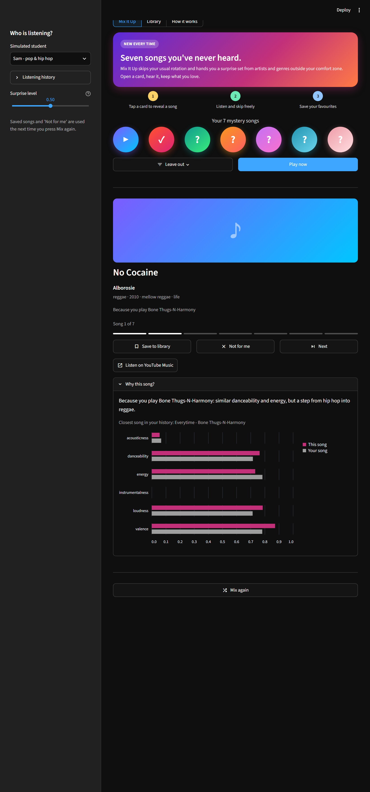
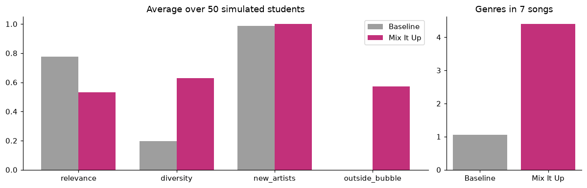

# Mix It Up - a discovery recommender for YouTube Music

**Technical handbook** for the UX challenge *YouTube Music redesign*.
Mix It Up gives a student, with one tap, **seven songs they have never heard**:
based on their taste, but deliberately outside their usual bubble. The cards are
hidden behind a question mark, a *Leave out* filter excludes genres or artists,
and every song explains *why* it was picked.

This repository re-creates the core of a YouTube-Music-style recommender in
Python and extends it with the Mix It Up algorithm.



---

## Quick start

```bash
git clone https://github.com/JSolChacon/mix-it-up-youtube-music.git
cd mix-it-up-youtube-music
pip install -r requirements.txt

# 1. the clickable demo
streamlit run app/streamlit_app.py

# 2. the experiments
jupyter notebook notebooks/mix_it_up_experiments.ipynb
```

The dataset is included in `data/` (see [data/README.md](data/README.md)).
Python 3.10 or newer. Training takes about 5 seconds on a laptop.

## Project structure

```
mix-it-up/
├── app/streamlit_app.py          clickable demo (screens B-03 to B-06 of the design)
├── data/tcc_ceds_music.csv       Kaggle "Music Dataset: 1950 to 2019"
├── docs/images/                  figures and code images used in the report
├── notebooks/
│   └── mix_it_up_experiments.ipynb   all experiments, with outputs
├── src/
│   ├── data.py                   load data, build song vectors
│   ├── recommender.py            BaselineRecommender and MixItUp
│   └── evaluate.py               simulated students and metrics
└── tools/                        scripts that rebuild the notebook and code images
```

## How it works

```
CSV ──► song vectors ──► K-Means taste regions ──► user's bubble ──► filters ──► quota + MMR ──► 7 songs + "why"
         (data.py)            (recommender.py)                                         
```

### 1. Song vectors (`src/data.py`)
Every song becomes one vector made of four blocks, each normalised and weighted:

| Block | Technique | Weight |
|---|---|---|
| Audio: danceability, loudness, acousticness, instrumentalness, valence, energy | `StandardScaler` | 1.0 |
| Genre (7) | one-hot encoding | 1.0 |
| Lyric topics (16 LDA scores) | `StandardScaler` | 0.6 |
| Lyrics | **TF-IDF + Truncated SVD** (Latent Semantic Analysis, 24 themes) | 0.6 |

The final vector has length 1, so the dot product of two songs is their cosine similarity.

### 2. Baseline - "YouTube Music today" (`BaselineRecommender`)
Content-based **k-Nearest Neighbours**: average the vectors of everything the user
played (weighted by play count) and return the 7 nearest songs. Accurate, but it
stays inside one genre: this reproduces the *bubble* found in the UX research.

### 3. Extension - Mix It Up (`MixItUp`)
1. **K-Means (k = 10)** groups the catalogue into taste regions (k chosen with elbow + silhouette).
2. **Robust profile:** only regions with at least 15% of the user's plays count, so one odd song does not pollute the mix.
3. **Hard filters:** only artists the user never played, nothing almost identical to a known song (cosine > 0.92), and the *Leave out* genres / artists / topics.
4. **Comfort-zone quota:** `round(7 × surprise)` songs must come from the nearest regions *outside* the bubble.
5. **Maximal Marginal Relevance:** every next pick balances relevance with being different from the picks so far; max one song per artist. A bit of random noise makes the mix *new every time*.
6. **Why this song?** The closest song in the user's history plus the audio features they share.
7. **Feedback:** *Save* and *Not for me* move the profile (Rocchio relevance feedback).

## Results (50 simulated students, see the notebook)

| | relevance | diversity | genres in 7 songs | new artists | outside bubble |
|---|---|---|---|---|---|
| Baseline (k-NN) | 0.78 | 0.20 | 1.1 | 99% | 0% |
| **Mix It Up** (surprise 0.5) | 0.53 | **0.63** | **4.4** | **100%** | **57%** |

* **Surprise sweep:** relevance goes down and discovery goes up in a smooth, controllable way.
* **Pollution test:** one odd song with up to ~9% of all plays moves the baseline (drift 0.07) but not Mix It Up (drift ≈ 0.00).
* **Leave out:** 0 violations in 50 mixes; filtering everything shows the empty state.
* **Feedback loop:** the share of saved songs rises from 42% to 72% in six rounds (without feedback: ~42%).
* **Logistic Regression** learns what a student saves (ROC-AUC 0.86) and gives explainable coefficients.



## Limitations
* No real listening data: users are simulated personas.
* The dataset stops in 2019 and some genre labels are wrong (e.g. some rap artists are tagged *pop*).
* No audio playback: the app links to a YouTube Music search instead.
* Relevance is measured with the same vectors the models use; a real A/B test with students is the next step.

## Ideas for more data
* **Spotify Million Playlist Dataset** - real co-listening for collaborative filtering.
* **Last.fm 1K / LFM-2b** - real listening histories with timestamps (recency, sessions).
* **Kaggle "Spotify Tracks Dataset"** (114k songs, 125 genres) - richer and more recent genres.
* **Music4All** - audio clips, lyrics and tags for 109k songs.

## Design
The screens this code implements (flow B, *Mix It Up*) are in the
[Claude Design prototype](https://claude.ai/artifact/1joiSpqVeWu1r3aejTLuca).

## Rebuild
```bash
python tools/build_notebook.py        # re-runs all experiments, saves figures to docs/images
python tools/render_code_images.py    # code images used in the report
```

## References
* Carbonell, J., & Goldstein, J. (1998). The use of MMR, diversity-based reranking for reordering documents and producing summaries. *SIGIR '98*, 335-336. https://doi.org/10.1145/290941.291025
* Covington, P., Adams, J., & Sargin, E. (2016). Deep neural networks for YouTube recommendations. *RecSys '16*, 191-198. https://doi.org/10.1145/2959100.2959190
* Kaminskas, M., & Bridge, D. (2016). Diversity, serendipity, novelty, and coverage. *ACM TiiS, 7*(1), 1-42. https://doi.org/10.1145/2926720
* Moura, L., Fontelles, E., Sampaio, V., & França, M. (2020). *Music dataset: Lyrics and metadata from 1950 to 2019* (V3) [Data set]. Mendeley Data. https://doi.org/10.17632/3t9vbwxgr5.3
* Pedregosa, F., et al. (2011). Scikit-learn: Machine learning in Python. *JMLR, 12*, 2825-2830.

Made by Juan as part of the UX challenge *YouTube Music redesign*. Dataset license: CC BY 4.0.

The full technical report (Dutch) is in [docs/Technische_documentatie_Mix_It_Up.docx](docs/Technische_documentatie_Mix_It_Up.docx).
